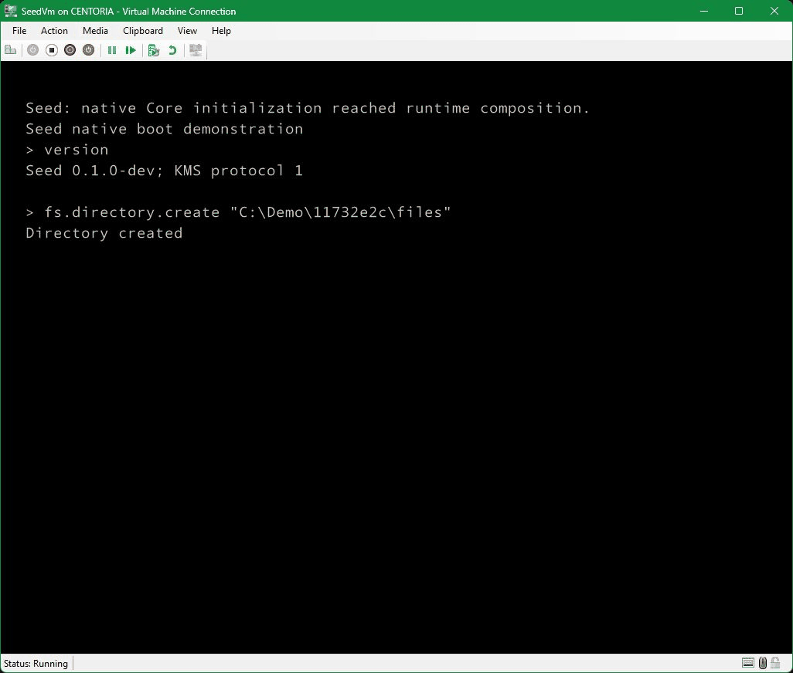

# Seed

Seed is a source-distributed C++ runtime for Windows x64 built directly on NTAPI.
Its native executable uses a custom `EntryPoint`, links without the standard C/C++
runtime and, with the default Native subsystem, imports only `ntdll.dll`. Memory
allocation, containers, reference counting, exceptions, async IO and service
composition are implemented inside Seed.

The same native runtime provides DNS, DHCP, HTTP/1.1, TLS and cryptography.
Networking uses AFD sockets and NSI interface queries through NTAPI. HTTP and TLS
run on Seed's async byte streams. The managed console, startup adapter and test
peers remain outside the native process.

Native types declare compile-time reflection (CTTI) records that produce runtime
metadata (RTTI). Native serialization and the C# metadata readers use these
records to exchange reflected values. The source SDK includes the compiler ABI,
lifetime rules and linker registration machinery needed by that runtime.

## What you can use it for

- **Native Windows service composition:** build an NTAPI application from Seed's
  containers, async IO, DI and protocol components, using `Seed.Runtime` as the
  reference composition.
- **Native/C# data exchange:** export live native RTTI, map reflected records to
  managed types and exercise JSON or binary round trips with the shipped examples.
- **Protocol development:** inspect and test HTTP/1.1 and TLS client/server
  behavior against independent peers, including framing and certificate failures.
- **Runtime research:** study custom exception handling, interruption, allocation,
  retained metadata and Windows native-image startup in a controlled environment.

## Source SDK

### Native components

- [`Seed.MinCore`](Lib/Seed.MinCore): primitive types, traits, atomics, ownership
  helpers and compiler-facing foundations used by the rest of the runtime.
- [`Seed.RTTI` compiler support](Lib/Seed.RTTI): the compiler-facing type-info ABI
  used alongside Seed's explicit CTTI/RTTI records.
- [`Seed.Core`](Native/Seed.Core.vcxitems): allocation, containers, exceptions,
  threading, async tasks/IO, diagnostics, DI, reflection, binary/JSON serialization,
  DNS, DHCP and cryptography. It owns foundational services and their lifetimes.
- [`Seed.Http`](Native/Seed.Http.vcxitems): HTTP/1.1 message parsing, outbound
  requests, listeners and raw/reflected JSON endpoint handlers over Seed transport.
- [`Seed.Tls`](Native/Seed.Tls.vcxitems): TLS 1.2/1.3 client/server streams,
  certificate validation/providers and RSA server identities. Private keys and
  traffic secrets use sensitive memory; protocol and release limits are documented
  in the generated TLS reference.
- [`Seed.KMS`](Native/Seed.KMS.vcxitems): local message-pipe transport and native
  command routing for runtime state, configuration, logs, tests, RTTI export,
  file operations, processes and Windows registry values.
- [`Seed.Runtime`](Native/Seed.Runtime.vcxproj): the executable composition that
  registers services, loads host options, starts KMS and demonstration listeners,
  and coordinates shutdown or an in-process reload.

### Managed libraries and adapters

- [`Seed.Shared`](PublicAPI/Seed.Shared): shared primitive identities and metadata
  contracts for the managed libraries.
- [`Seed.CTTI`](PublicAPI/Seed.CTTI): attributes and contracts that map managed
  types and fields to native reflected records.
- [`Seed.Objects`](PublicAPI/Seed.Objects): selected Core records and the
  `DynamicObject` value envelope exposed to managed consumers.
- [`Seed.RTTI` reader](PublicAPI/Seed.RTTI): reads exported native metadata and
  exposes registered types, fields and callable records to managed code.
- [`Seed.Serialization`](PublicAPI/Seed.Serialization): constructs binary
  serializers from native metadata and mapped managed types.
- [`Seed.KMS.Transport`](API/Seed.KMS.Transport): a sequential managed client for
  finite commands, streamed output and reload reconnection over the local pipe.
- [`Seed.Starter`](API/Seed.Starter): an external NT process-creation adapter used
  by managed launchers to start the native executable.

Foundational managed libraries target `netstandard2.0`; serialization and the
external developer tools use .NET 10.

### Demonstrations and verification tools

- [`Seed.Console`](Launcher/Seed.Console): starts or connects to a runtime and
  exposes its commands through an interactive prompt or one-command invocation.
- [`Seed.Native.HttpClient`](Examples/Seed.Native.HttpClient): launches a native
  HTTP/HTTPS request and saves the response, module inventory and diagnostics.
- [`Seed.Managed.RoundTrip`](Examples/Seed.Managed.RoundTrip): reads live RTTI,
  maps C# records and checks local serialization plus native JSON/binary exchanges.
- [`Seed.E2E.Infrastructure`](Lib/Seed.E2E.Infrastructure) and
  [`Seed.E2ETests`](Testing/Seed.E2ETests): own ordinary-user runtime processes,
  bounded KMS exchanges, fast-reboot regressions and retained TRX reports.
- [`Seed.Testing.TestAdapter`](Tools/Seed.Testing.TestAdapter): integrates native
  test discovery and selected execution into Visual Studio through the separate
  [`Seed.Testing.Host`](Tools/Seed.Testing.Host) process.
- [`Seed.XMLDocGen`](Tools/Seed.XMLDocGen): generates the local documentation wiki,
  component source map and API reference from shipped sources and compiler XML.
- [`Docker`](Docker): Windows source-build, test and runtime images, with
  ordinary-user container execution and retained verification reports.

Native delivery uses source components and MSBuild shared items. Version 0.1 does
not promise a stable native binary ABI. Reflection data must match the runtime
that produced it.

## Build

Use Windows x64, Visual Studio 2026 with MSVC v145, a Windows SDK and .NET 10.
Local runtime verification also requires PowerShell 7.
Run from the checkout root in a Visual Studio Developer PowerShell session.
The initial validation targets are Windows 11 24H2 and Windows Server 2025.

```powershell
./Tools/Update-NtdllImportLibrary.ps1
MSBuild Seed.slnx /m /restore /p:Configuration=Debug /p:Platform=x64
```

Native builds use all available cores and may require substantial memory and
pagefile capacity. Debug, Release and Coverage configurations are defined.
Outputs go to `Artifacts/x64/<Configuration>/`; use matching native and managed
builds. The default `SeedSubsystem=Native` retains the NTAPI process boundary.
`/p:SeedSubsystem=Console` or `/p:SeedSubsystem=Windows` changes the image subsystem
while preserving the custom entry point; Windows loads additional Win32 modules
for those variants.

## Demonstrations and console

Run the following from the checkout root in a non-elevated PowerShell session
after a Debug build. Substitute Release consistently for a Release build. Start
one default host at a time: its pipe and loopback ports are shared endpoints.

### Start the native host

The managed console launches the native image through `Seed.Starter` and connects
to KMS. This invocation prints status and disconnects, leaving the host running:

```powershell
./Artifacts/x64/Debug/Seed.Console/Seed.Console.exe --start ./Artifacts/x64/Debug/Runtime/Seed.Runtime.exe status.kernel
```

To connect to an existing host, omit `--start` and the runtime path. A trailing
command runs once:

```powershell
./Artifacts/x64/Debug/Seed.Console/Seed.Console.exe status.kernel
./Artifacts/x64/Debug/Seed.Console/Seed.Console.exe reload
```

Invoke `Seed.Console.exe` without arguments for an interactive `seed>` prompt.
The KMS endpoint serves one session at a time; exit an interactive session before
opening another console or running a one-command invocation.

`exit` disconnects a console; `shutdown` stops the runtime. `reload` rebuilds its
service composition inside the same process. The client waits for initialization
and reconnects before completing the command, including saved pipe-name changes.
Unsaved edits are discarded. The wait is bounded to one minute and accepts Ctrl+C.
Sessions use the local `Seed.KMS.v1` pipe, reject remote clients and connect without
a login exchange. Use `--pipe <local-Seed-name>` before `--start` or a command to
select a configured endpoint.

### Exercise HTTP and managed interoperability

While the host is running, query its loopback listener:

```powershell
Invoke-RestMethod http://127.0.0.1:8080/health
Invoke-RestMethod http://127.0.0.1:8080/json -Method Post -ContentType 'application/json' -Body '{"Sequence":42,"Message":"Hello from Seed"}'
```

`GET /health` returns a runtime health message. `POST /echo` returns raw bytes.
`POST /json` reflects `Seed::Runtime::RoundTripMessage`; `POST /binary` validates
the matching type identity and bounded envelope before native deserialization.
The binary route accepts the demonstration DTO only.

The managed round-trip example reads live RTTI and checks C# serialization and
native JSON/binary exchanges. The generated demonstrations page gives the export
and invocation steps. It also documents enabling HTTPS on `https://localhost:8443`
with fresh development certificate/key files and explicit client trust.

### Run the outbound native client

This launcher starts a short-lived native process that performs HTTP, TLS, DNS
and cryptography and saves its response:

```powershell
./Artifacts/x64/Debug/Seed.Native.HttpClient/Seed.Native.HttpClient.exe --url https://example.com/ --output ./Artifacts/response.txt
```

Use `--trust-root <DER-file>` for an explicit development trust root and `--tls
1.2` or `--tls 1.3` to restrict negotiation. Use `--runtime <path>` for a Release
runtime; the launcher otherwise selects the Debug native executable.
Response bodies, headers, loaded-module inventories and failure diagnostics are
written next to the selected output file.

### Run in a Windows container

With a compatible Docker Windows-container engine, build the runtime image and
start its ordinary-user supervisor:

```powershell
./Tools/Build-SeedDocker.ps1 -Configuration Release -Target runtime
docker run --detach --name seed-demo --isolation process seed:runtime-local
docker exec seed-demo C:\Seed\Console\Seed.Console.exe status.kernel
```

Wait for the supervisor's startup message before sending commands. Use
`-Isolation hyperv` for the build and `--isolation hyperv` for the container when
required by host/image compatibility. The generated Docker page covers those
requirements and memory limits. HTTP binds to container loopback by default.
When finished, request orderly shutdown before removing the container:

```powershell
docker exec seed-demo C:\Seed\Console\Seed.Console.exe shutdown
docker wait seed-demo
docker rm seed-demo
```

### Native commands during Windows boot



Seed creates, reads, copies and renames files, displays file and process tables,
reads a Windows registry value and exports live reflection metadata before
returning to Windows startup. Shown on Windows Server 2025, x64 Debug.

## Console commands

Run these at the interactive prompt or pass a command and its arguments to
`Seed.Console.exe`. Angle brackets mark required arguments; brackets mark optional
arguments. Export and report paths refer to files on the runtime's machine.

- `help`: list the implemented command names.
- `commands`: list the same command catalogue as `help`.
- `version`: print the Seed build version and KMS protocol version.
- `exit`: close the current console session, leaving the runtime running.
- `status.kernel`: show the composition identifier, uptime, allocated bytes and
  registered service count.
- `shutdown`: request runtime shutdown and service cleanup.
- `reload`: rebuild the runtime composition in the same process and wait for KMS
  reconnection before completing.
- `configurations.list`: list exposed Core and host settings, values and constraints.
- `configurations.get <name>`: inspect one listed setting.
- `configurations.set <name> <value>`: validate and change a setting; host edits
  require save and reload to take effect.
- `configurations.save`: explicitly persist Core settings and pending host options.
- `configurations.reset [name]`: restore one setting, or all exposed settings and
  pending logger overrides, to compiled defaults; save explicitly to persist.
- `logging.view`: read the last 100 buffered Core log lines.
- `logging.get [module-name]`: list dynamic logger masks or read one named logger.
- `logging.set <mask> <module-name>`: change a live logger mask in the range 0..31;
  save the configuration to retain its host override.
- `logging.follow`: stream new log output until Ctrl+C or disconnection.
- `tests.list`: list registered native test type names.
- `tests.run [selection ...]`: run exact test type names or wildcard selections,
  such as `*Crypt*`, or all tests when omitted; overlapping selections execute
  each test once.
- `tests.result.store <file>`: save the most recent completed run as NUnit XML.
- `di.rtti.list`: list registered types in the live RTTI section.
- `di.rtti.save <file>`: export live, fixed-up RTTI for the matching managed tools.
- `network.interfaces`: list interface indices and names through native queries.
- `network.dns.resolve <name>`: resolve a DNS name using Seed's DNS service.
- `network.dhcp.start <interface-index>`: explicitly request lease acquisition on
  a connected eligible interface without a usable IPv4 address.
- `network.dhcp.status`: report lease workers, acquisition errors and pending cleanup.
- `network.dhcp.stop <interface-index>`: cancel and join a lease worker, then release
  its owned interface configuration. Actual DHCP mutation needs isolated validation.
- `fs.list <directory>`: list immediate files and directories with byte sizes.
- `fs.info <file>`: show a file's native path and byte size.
- `fs.read <file>`: read a UTF-8 text file of at most 65,536 bytes.
- `fs.write <file> <text>`: create a new UTF-8 file without replacing an existing file.
- `fs.directory.create <directory>`: create one directory under an existing parent.
- `fs.copy <source> <destination>`: copy a file without replacing the destination.
- `fs.move <source> <destination>`: rename a file or directory on the same volume,
  without replacing the destination.
- `fs.delete <path>`: delete one file or an empty directory.
- `process.list`: show process IDs, parent IDs and image names.
- `process.terminate <pid>`: terminate one accessible process; rejects the idle,
  System, current Seed and critical processes.
- `registry.list <key>`: list immediate subkeys and value names/types.
- `registry.get <key> <value-name>`: read a string, DWORD or QWORD; summarize other types.
- `registry.set <key> <value-name> <string|dword|qword> <value>`: create or replace
  one value in an existing key; numeric values use unsigned decimal notation.
- `registry.key.create <key>`: create or open one key under an existing parent.
- `registry.key.delete <key>`: delete a key and its values; subkeys prevent deletion.
- `registry.value.delete <key> <value-name>`: delete one value.

File commands require absolute DOS or NT paths. Registry commands accept
`HKCU\...`, `HKLM\...` or `\Registry\...`. Quote arguments containing spaces;
inside a quoted argument, use `""` for a literal quote. Use `""` as the registry
value name for its default value. Commands use the runtime's existing Windows
rights. See the generated `system-commands.md` page for examples and limits.
## Documentation wiki

Generate the local Markdown wiki and API reference from the tracked source pages:

```powershell
./Tools/Invoke-SeedWorkflow.ps1 -Action Documentation
```

Open `Documentation/index.md` after generation. Build the native and managed
projects first to supply compiler XML for the full API reference. Generated files
under `Documentation/` are ignored; edit the topic sources in
[`Tools/Seed.XMLDocGen/Pages`](Tools/Seed.XMLDocGen/Pages) to keep changes durable.

- `system-commands.md`: file, process and Windows registry examples and limits.
- `demonstrations.md`: console startup, HTTP routes, managed round trips, HTTPS
  identity setup and outbound client options.
- `configuration.md`: Core/host envelopes, storage locations, validation, setting
  ranges and explicit save/reload behavior.
- `kms.md`: pipe protocol, command execution, logging masks/streaming, cancellation
  and reload reconnection.
- `networking.md`: AFD/NSI transport, DNS and DHCP worker ownership and cleanup.
- `tls.md` and `cryptography.md`: protocol/key formats, trust, listener limits and
  outstanding cryptographic release acceptance.
- `testing.md`, `e2e.md` and `test-adapter.md`: verification, retained NUnit/TRX
  reports, selected execution and Visual Studio adapter packaging/debugging.
- `docker.md` and `boot-debugging.md`: container compatibility/execution and the
  separate native boot test-VM workflow.

## Verification

After building, run native tests and the owned-runtime integration checks in a
non-elevated PowerShell 7 session, separately from a manually running default host:

```powershell
./Tools/Invoke-SeedWorkflow.ps1 -Action Tests -NoBuild
./Tools/Test-SeedIntegration.ps1
./Tools/Test-SeedE2E.ps1 -NoBuild
./Tools/Test-SeedTestAdapter.ps1
```

Use `./Tools/Invoke-SeedValidation.ps1 -Configuration Release` for the complete
local sequence after building the matching solution. Hardware-dependent skips
remain visible separately in NUnit reports; failed and interrupted tests fail
verification. `./Tools/Test-SeedDocker.ps1` owns container verification and copies
reports to `Artifacts/docker/` before cleanup. Ordinary E2E tests do not mutate
DHCP interfaces.

## Licensing and contribution

Apache-2.0 is selected for Seed-owned code, subject to the pending contribution
and historical rights audit. Imported support headers in this local extraction
are audit inputs and are not yet cleared for redistribution. Upstream phnt is
[MIT licensed](https://github.com/winsiderss/phnt/blob/master/LICENSE); its
attribution must remain with any approved derived material.

See [AGENTS.md](AGENTS.md) for runtime invariants and documentation rules.
Contributions must include a Developer Certificate of Origin sign-off
(`git commit -s`) confirming the right to contribute the submitted material.
